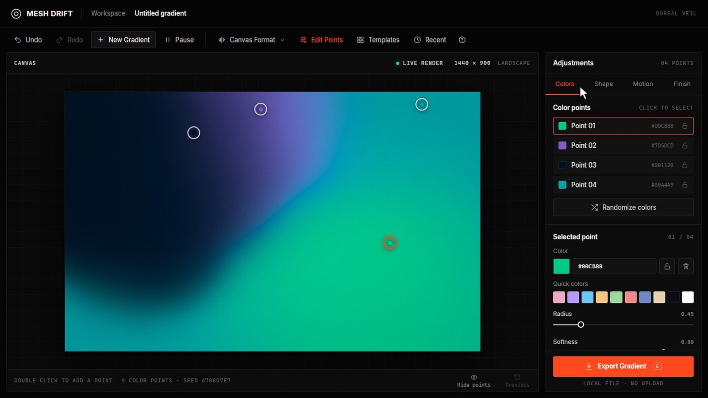
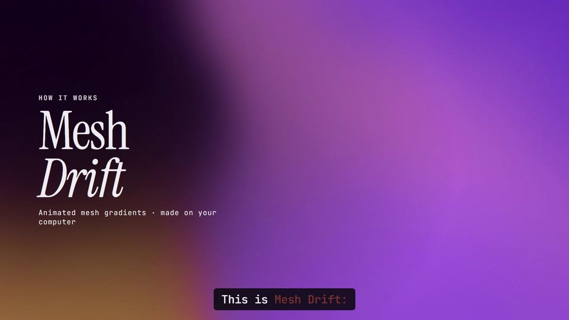
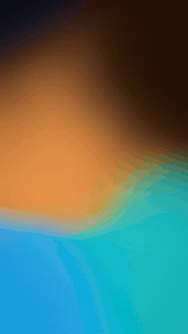
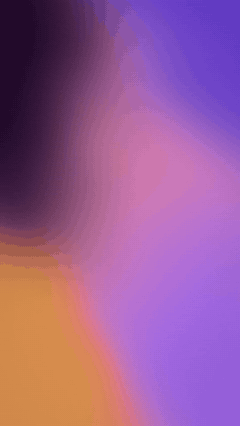
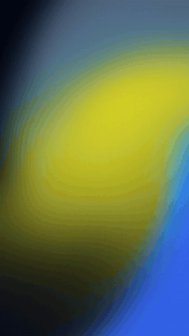
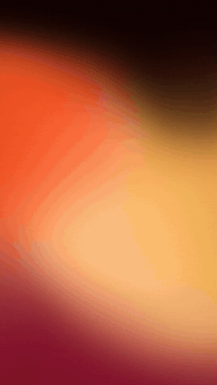
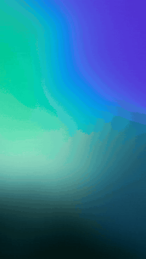
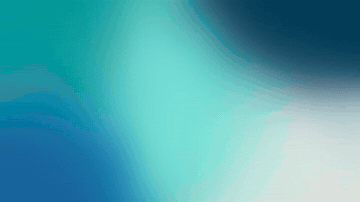

# Mesh Drift

Animated mesh gradients for backgrounds, reels and brand visuals. Make a gradient, drag its colour points, pick a
motion, and export a still or a seamless video loop.

**Everything runs on your computer. No account, no API key, nothing is uploaded.** The app needs no Python packages:
only Python itself, plus ffmpeg if you want MP4.

Inspired by a gradient tool shown in a reel by [Daniil](https://www.instagram.com/reel/Dd2FvritqAG/). Mesh Drift is an
independent project, not affiliated with that tool, and shares no code with it.



<!-- videos:start -->
## See it in action

<p align="center"><a href="docs/videos/tutorial.mp4"></a><br><b>▶ <a href="docs/videos/tutorial.mp4">How it works</a></b> (0:59, narrated, with captions)</p>

**Made with Mesh Drift: seamless loops in five of the six motion modes**

<table><tr>
<td width="33%" align="center"><a href="docs/videos/examples/drift.mp4"></a><br><a href="docs/videos/examples/drift.mp4">Drift</a></td>
<td width="33%" align="center"><a href="docs/videos/examples/flow.mp4"></a><br><a href="docs/videos/examples/flow.mp4">Flow</a></td>
<td width="33%" align="center"><a href="docs/videos/examples/orbit.mp4"></a><br><a href="docs/videos/examples/orbit.mp4">Orbit</a></td>
</tr><tr>
<td width="33%" align="center"><a href="docs/videos/examples/breathe.mp4"></a><br><a href="docs/videos/examples/breathe.mp4">Breathe</a></td>
<td width="33%" align="center"><a href="docs/videos/examples/tide.mp4"></a><br><a href="docs/videos/examples/tide.mp4">Tide</a></td>
<td width="33%" align="center"><a href="docs/videos/examples/landscape.mp4"></a><br><a href="docs/videos/examples/landscape.mp4">Landscape loop</a></td>
</tr></table>

Click any picture to play the video.
<!-- videos:end -->

## Install

You need:
- Windows 10 or 11 (it is built and tested on Windows 11)
- [Python](https://www.python.org/downloads/) 3.10 or newer
- Google Chrome or Microsoft Edge (WebGL2, and WebCodecs for video export)
- [ffmpeg](https://ffmpeg.org/download.html) on your PATH, only for MP4 export

```
python launch.pyw
```

Optional: `powershell -ExecutionPolicy Bypass -File make_shortcut.ps1` puts a **Mesh Drift** shortcut on your Desktop.

## How it works
- **Every visit** starts on a fresh gradient: a new seed, palette, point layout and gentle motion. The last session is
  saved in **Recent**, and **Previous** (bottom right of the canvas) brings it back. Press Previous again to swap back.
- **New Gradient** (or **N**) rolls everything again. The gradient you leave goes into Recent.
- **The canvas**:
  - Drag a colour point to move its colour.
  - Double-click to add a point (up to 16).
  - **Edit Points** or **Hide points** (**H**) shows or hides the handles.
- **Canvas Format**: Portrait 900×1440, Story/Reel 1080×1920, Post 1080×1350, Square, Landscape 1440×900, Widescreen
  1920×1080, Banner 1500×500, or any custom size.
- **Templates**: a pack of 14 hand-picked looks (Duotone Haze, Violet Dusk, Midnight Arc, Aurora, …).
- **Adjustments** has four tabs:
  - **Colors**: the point list with a lock on each row, **Randomize colors**, and the **Selected point**: hex field,
    colour picker (square, hue strip, RGB, eyedropper), quick colours, **Radius**, **Softness** and **Influence**.
  - **Shape**: Scale, Blend, Stretch X/Y and Rotation. **Advanced shape**: Warp, Warp detail and Swirl.
    **Generate variation** makes a new arrangement that keeps your colours.
  - **Motion**: six modes (Still, Drift, Orbit, Breathe, Flow and Tide), with Duration (the loop length), Intensity,
    Direction, Smoothness and Warp speed. **Randomize motion**.
  - **Finish**: Grain, Grain size, Animated grain, Exposure, Contrast, Saturation, Hue shift and Vignette.
- **Locked points** keep their colour and place through New Gradient, Randomize colors and Generate variation.
- **Undo / Redo** (Ctrl+Z, Ctrl+Shift+Z or Ctrl+Y) covers every change. Double-click a slider's name to reset it.
- **Export** (**E**):
  - **PNG, WEBP, JPEG**: any width and height (it keeps the canvas shape); ×1, ×2 or ×4, up to 4096 px on the long edge.
  - **WEBM**: a seamless loop, rendered frame by frame at full size. HD, 2K or 4K; 30 or 60 fps; 3, 5 or 10 s. The
    motion is fitted to whole loops, so the last frame flows back into the first.
  - **MP4**: the same loop, converted to H.264 with ffmpeg.
  - Files go to `Videos\Mesh Drift` in your user folder. Set the `MESH_DRIFT_OUT` environment variable to use another
    folder. Existing files are never overwritten. **Show in folder** in the message opens the file in Explorer.
- Press **?** in the app for every shortcut.

## What's where
- `static/`: the window.
  - `index.html` and `app.css` lay out the page.
  - `js/main.js` connects the controls to the engine.
  - `js/renderer.js`: the WebGL2 shader. It blends the points in OKLab, then adds swirl, noise warp, tone, vignette,
    grain and a dither against banding.
  - `js/motion.js`: the six motion modes. They all loop and rest on your points at t = 0.
  - `js/generate.js`: seeded palettes (12 colour strategies) and point layouts, locks and templates, and
    `sanitizeDoc`, which repairs stored gradients.
  - `js/exporter.js`: image export, and video export with WebCodecs (VP9).
  - `js/webm.js`: a small WebM writer with Duration, SeekHead and Cues, so players can seek straight away.
  - `js/history.js`: undo/redo and Recent. `js/sizes.js`: formats and export sizes. `js/picker.js`: the colour
    picker. `js/color.js`: OKLab, OKLCH and HSV maths.
- `server.py`: a small local server built only on the Python standard library, on `127.0.0.1:47885`. It serves the
  window and saves exports; MP4 goes through ffmpeg. When started from the launcher, it quits about 2½ minutes after
  the window closes.
- `launch.pyw`: the launcher. It opens a Chrome (or Edge) app window, with its own profile in
  `%LOCALAPPDATA%\MeshDrift\window`.
- `make_icon.py` and `make_shortcut.ps1` rebuild the icon and the Desktop shortcut.
- Logs: `%LOCALAPPDATA%\MeshDrift\app.log`.

## Tests
```
node --test "tests/js/*.test.mjs"                          # engine: colour, generation, locks, motion loops, sizes, history, WebM writer
python -m unittest discover -s tests -p test_server.py     # server: saving, no overwrite, safe names, MP4 transcode
python tests/test_e2e.py                                   # the whole app in Chrome, with a review folder
```
The end-to-end run needs Playwright, numpy and Pillow (`python -m pip install playwright numpy pillow`). It clicks,
drags and types through every feature, exports every file type, checks the files with ffprobe (codec, size, frame
count, a seamless loop, motion in every mode) and writes `Test Report.html` to a review folder on your Desktop.

## Credits
- Inspiration: a gradient tool shown in a reel by [Daniil](https://www.instagram.com/reel/Dd2FvritqAG/).

## Licence

MIT, see [LICENSE](LICENSE).
